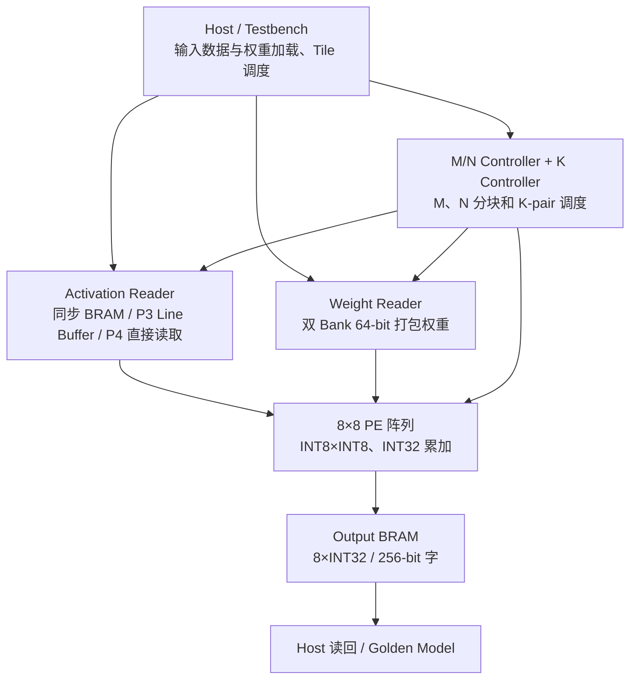

# ResNet-18 卷积神经网络加速器：项目说明与开发规划

> **课题名称**：《面向图像分类的卷积神经网络加速器设计与实现》  
> **文档版本**：v1.3｜2026-11-15（P5-B1：Weight BRAM 共享、六次连续多模式仿真 PASS、Post-Route PhysOpt 内部时序通过）  
> **开发仓库**：[magictrees25/fpga-accelerator](https://github.com/magictrees25/fpga-accelerator)  
> **当前工作分支**：`p5-b1-weight-bram-sharing`；本文档为本地版本，不自动推送 GitHub  
> **硬件验证工具**：SystemVerilog、Vivado 2023.2、XSim  
> **已报告的实现器件**：Xilinx Artix-7 `xc7a100tcsg324-1`；**时钟目标**：100 MHz

**项目状态一句话总结**：P3、P4-C、P4-D3 已分别完成代表卷积层的完整 Tile 功能回归；P5-A 已将 **3×3/S1、1×1/S2、3×3/S2** 三种配置接入同一套 8×8 PE 与 K/M/N 控制核心；P5-B1 进一步把原来两套 Weight Reader 合并为一套双 Bank Shared Weight Reader。P5-B1 六次连续多模式仿真 **1,536/1,536 INT32 输出 PASS**；Post-Route PhysOpt 后 BRAM 从 13 Tile 降至 11 Tile，DSP 保持 64，100 MHz 约束下内部 Setup/Hold 检查通过（WNS +0.038 ns、WHS +0.014 ns）。**当前仍不是自动调度的 ResNet-18 整网系统，也没有真实 FPGA 板级吞吐、延迟或功耗测量；I/O 延迟约束仍不完整。**

> 版本变化记录：详见本地 `ResNet18_CHANGELOG_v1.3.md`。P4-C、P4-D 的功能 PASS 由 Vivado Transcript 截图支持；P5-B1 的仿真、Implementation 与 PhysOpt 数据来自用户运行结果及当前 GitHub 分支 `p5-b1-weight-bram-sharing` 中的报告。本次 v1.3 文档**仅更新本地文件，不推送 GitHub**。

---

## 目录

1. [研究目标和范围](#1-研究目标和范围)
2. [ResNet-18 网络结构及计算需求](#2-resnet-18-网络结构及计算需求)
3. [卷积到 GEMM 的映射与硬件数据通路](#3-卷积到-gemm-的映射与硬件数据通路)
4. [现有 RTL 模块及仓库组织](#4-现有-rtl-模块及仓库组织)
5. [已完成工作和阶段验收](#5-已完成工作和阶段验收)
6. [P2.1 与 P3 性能对比](#6-p21-与-p3-性能对比)
7. [P4：1×1/S2 与 3×3/S2 卷积适配](#7-p411s2-与-33s2-卷积适配)
8. [P5：统一多模式与 Weight BRAM 共享](#8-p5-统一多模式与-weight-bram-共享)
9. [后续开发路线和阶段计划](#9-后续开发路线和阶段计划)
10. [验证方法、实验记录及验收标准](#10-验证方法实验记录及验收标准)
11. [风险、边界与论文成果规划](#11-风险边界与论文成果规划)
12. [后续维护记录](#12-后续维护记录)

---

## 1. 研究目标和范围

### 1.1 课题定位

本课题以 **ResNet-18 图像分类**为代表网络，重点开展卷积计算硬件架构的 RTL 设计和优化。核心工作是：

- 自行设计与验证 **INT8 卷积加速计算核心**，而不是把全部开发工作交给现成 DPU。
- 设计 **8×8 PE 阵列、K/M/N 分块调度、激活/权重供给和输出缓存**。
- 研究 **数据复用、片上存储组织、读写带宽、流水线调度以及时序优化**。
- 用 Vivado/XSim 完成功能验证、综合、实现和可复现实验；条件允许时再开展 FPGA 板级测试。
- 保留 CPU/Host、HLS 或其他模块完成 BN、ReLU、池化、残差加法、量化、数据搬运等非核心任务的可能性；这些属于后续系统集成范围，**不能当作已经实现**。

### 1.2 当前设计边界

当前 RTL 是一个**逐 Tile 加载、逐 Tile 计算的卷积加速原型**。Host/Testbench 负责按照空间位置和输出通道组织输入数据，再驱动单 Tile 核执行。

| 类别 | 当前情况 |
|---|---|
| 运算精度 | 有符号 INT8 激活、INT8 权重；INT16 乘积、INT32 累加结果 |
| PE 阵列 | 8×8，共 64 个 PE |
| P2/P3/P4 计算方式 | 每拍消费一个 K-pair，即 2 个 K 元素；读数据同步响应 |
| 输出缓存 | 一个输出位置的 8 路 INT32 打包成 256-bit 字，支持按 lane 读回 |
| 数据加载 | 当前由 Testbench 逐项加载；尚非外部 DDR/AXI DMA 数据通路 |
| 可配置性 | 部分控制器参数可变，但 P3 和 P4 Reader 仍是**针对指定卷积类型的独立实现** |
| 最终状态 | 已验证典型单层/单 Tile，不等于完成训练权重下的整网分类精度验证 |

### 1.3 评价指标

重点评估：**功能正确率、周期数、时钟频率与时序裕量、BRAM/Line Buffer 访问次数、Host 数据加载字节数、LUT/FF/LUTRAM/BRAM/DSP 资源**。功耗、能量以及 FPGA 板上吞吐率留待后续具备可信测量条件时再纳入正式结论。

---

## 2. ResNet-18 网络结构及计算需求

### 2.1 标准网络路径

采用常见的 ResNet-18 / ImageNet 224×224 配置，输入为 `224×224×3`，执行：

```text
224×224×3 输入
   │
   ├─ conv1: 7×7, stride 2, pad 3, 3→64       → 112×112×64
   ├─ MaxPool: 3×3, stride 2, pad 1           →  56×56×64
   ├─ layer1: 2 个 BasicBlock，均为 3×3/S1    →  56×56×64
   ├─ layer2: 2 个 BasicBlock，首块下采样      →  28×28×128
   ├─ layer3: 2 个 BasicBlock，首块下采样      →  14×14×256
   ├─ layer4: 2 个 BasicBlock，首块下采样      →   7×7×512
   ├─ Global Average Pooling                 →   1×1×512
   └─ 全连接分类层（ImageNet 示例 1000 类）  → 1000 维输出
```

**BasicBlock** 的主分支包含两层 3×3 卷积；当空间尺寸或通道数改变时，其 Shortcut 分支使用 1×1 卷积进行投影。因此，标准网络中有 3 个下采样 Shortcut 1×1 卷积，位于 `layer2.0.downsample.0`、`layer3.0.downsample.0`、`layer4.0.downsample.0`。

### 2.2 各阶段计算规模

对于普通卷积，按下式统计 **MAC（一次乘加记为 1 MAC）**：

\[
\mathrm{MACs}=H_{out}W_{out}C_{out}K_hK_wC_{in}
\]

| 部分 | 输出尺寸 | 代表卷积配置 | 卷积 MAC 总数* |
|---|---|---|---:|
| conv1 | 112×112×64 | 7×7/S2，3→64 | 118.014 M |
| layer1 | 56×56×64 | 4 层 3×3/S1，64→64 | 462.422 M |
| layer2 | 28×28×128 | 3×3/S2、3×3/S1、1×1/S2 Shortcut | 411.042 M |
| layer3 | 14×14×256 | 3×3/S2、3×3/S1、1×1/S2 Shortcut | 411.042 M |
| layer4 | 7×7×512 | 3×3/S2、3×3/S1、1×1/S2 Shortcut | 411.042 M |
| **卷积合计** | — | 包含 3 个投影 Shortcut | **1,813.561 M MAC** |

\*按标准网络尺寸与上述公式计算；包含卷积主分支和投影 Shortcut，不含 BN、池化、ReLU、残差求和以及全连接的计算。ImageNet 1000 类 FC 约 0.512 M MAC，按此口径加上约为 1,814.073 M MAC。不同工具把乘法与加法视为两个 FLOP 时，数字与 MAC 口径不能混用。

### 2.3 与当前硬件直接相关的典型层

| 代表层 | 卷积参数 | 完整输出 | GEMM 的 M | N | K | 当前阶段 |
|---|---|---|---:|---:|---:|---|
| `layer1.0.conv1` | 3×3/S1/P1，64→64 | 56×56×64 | 3,136 | 64 | 576 | P3 全层 PASS |
| `layer2.0.downsample.0` | 1×1/S2/P0，64→128 | 28×28×128 | 784 | 128 | 64 | **P4-C 完整层 PASS** |
| `layer2.0.conv1` | 3×3/S2/P1，64→128 | 28×28×128 | 784 | 128 | 576 | **P4-D3 全层 PASS** |
| `layer3.0.conv1` | 3×3/S2/P1，128→256 | 14×14×256 | 196 | 256 | 1,152 | 待适配 |
| `layer4.0.conv1` | 3×3/S2/P1，256→512 | 7×7×512 | 49 | 512 | 2,304 | 待适配 |
| `conv1` | 7×7/S2/P3，3→64 | 112×112×64 | 12,544 | 64 | **147（奇数）** | 仓库有早期 P1 验证路线，P2/P4 paired-K 尚需适配 |

特别注意：`layer4.0.conv2` 的 `K = 3×3×512 = 4608`。后续必须处理更大的 K、更多通道组以及缓存容量，不能因为 layer1 的 K=576 已通过就视为全部 ResNet-18 已支持。

---

## 3. 卷积到 GEMM 的映射与硬件数据通路

### 3.1 M/N/K 定义

\[
A_{M\times K}\times B_{K\times N}=C_{M\times N}
\]

- **M**：输出空间位置数，`M=Hout×Wout`；
- **N**：输出通道数，`N=Cout`；
- **K**：每个输出元素对应的卷积核展开长度，`K=Kh×Kw×Cin`。

硬件内部使用片段化的 M/N/K：M-tile 限制本次需要计算的输出位置，N-tile 选择本次 8 个输出通道，K 以同步请求的顺序读取。完整层的 Tile 顺序由 Host/Testbench 组织。

### 3.2 现有计算链路



**同步数据供给**：`S_CLEAR` 发起首对 K 请求；`S_FEED` 消费前一拍返回的两路激活和权重，同时请求下一对 K；`S_DRAIN` 等待阵列流水线排空，最后写回结果。现阶段为无 backpressure 的固定节拍方案。

### 3.3 计算阵列和数据类型

- `mac_unit.sv`：输入寄存、乘法寄存、累加寄存三级处理；INT8×INT8→INT16，再扩展到 INT32 累加。
- `systolic_array_p2.sv`：双 K 数据流进入 8×8 阵列，按行/列组织数据传播，并对同一输出通道的行部分和进行归约。
- `gemm_mn_controller_mem_p2.sv`：现有 P2/P3/P4 核心公用的计算调度模块；当前受测试接口限制，单次运行通常为 `N=8`，完整层更多 N-tile 在外部逐次运行。
- `k_tile_controller_p2.sv`：支持**正偶数 K**；P4 的 K=64 可直接复用。遇到 `conv1` 的 K=147，需通过零填充到偶数 K 或专门设计尾 K-pair 处理。

### 3.4 不要混淆的两种复用

1. **阵列/计算复用**：同一组 64 个 PE 在不同 M、N、K 上分时计算，不为每一层重新创建一整组 PE。
2. **数据复用**：例如 P3 Line Buffer 将相邻卷积窗口重复使用的激活保留在 LUTRAM 中，减少 Activation BRAM 请求。

P3 的优化重点是第二种。**读请求次数减少不意味着 MAC 数或 Compute cycles 自动减少。**

---

## 4. 现有 RTL 模块及仓库组织

### 4.1 主要目录

```text
fpga-accelerator/
├── rtl/                 # RTL 设计、PE/控制器/存储/顶层
├── tb/                  # XSim 功能与性能 Testbench
├── reports/             # Vivado 资源、时序、性能 CSV/RPT
│   ├── P2_1_WGT_OPT/
│   ├── P3/
│   ├── P5/
│   └── P5_B1/PhysOpt/
├── verification/        # 软件参考/辅助验证（以仓库实际内容为准）
├── doc/                 # 技术记录与规划文档
└── fpga_ai_accelerator/ # 保存的 Vivado 工程相关文件
```

**重要提示**：`rtl/` 以及早期集成工程目录可能包含同名模块；在 Vivado 中应按当前顶层管理来源，避免把所有历史版本一股脑递归编译到同一个设计中。

### 4.2 模块与用途

| 模块 | 主要作用 | 适用范围/状态 |
|---|---|---|
| `mac_unit.sv` | 8-bit MAC、32-bit 累加 | P2/P3/P4 复用 |
| `systolic_array_p2.sv` | 8×8 双 K 数据流计算阵列 | P2/P3/P4 复用 |
| `k_tile_controller_p2.sv` | K-pair 预取、FEED、DRAIN、结束控制 | 正偶数 K，可继续复用 |
| `gemm_mn_controller_mem_p2.sv` | 片内 M/N/K 运行与输出写回时序 | 当前一次 N=8，M≤64 |
| `sync_fmap_bram.sv` | 同步读的 Activation RAM 模型 | 可复用，深度由 Reader 实例化时指定 |
| `sync_weight_bram.sv` | 同步读的 64-bit Weight RAM 模型 | 可复用，深度由 Reader 指定 |
| `output_bram.sv` | INT32 输出缓存和读回 | P2/P3/P4 复用 |
| `conv_bram_reader_p2_opt.sv` | 3×3/S1 直接 BRAM 读取，地址优化 | P2.1 基线 |
| `conv_weight_bram_reader_p2_opt.sv` | K=576 的双路权重 Reader | P2.1/P3 |
| `conv_bram_reader_p3.sv` | 3×3/S1 激活 Line Buffer 数据供给与预取 | P3 专用，固定 10×10×64 |
| `conv_activation_line_buffer_p3.sv` | 4 行双 Bank LUTRAM 缓存 | P3 专用 |
| `conv_bram_reader_p4_1x1.sv` | 1×1/S2，M16、K64 激活读取 | P4-A PASS |
| `conv_weight_bram_reader_p4_1x1.sv` | 1×1/S2，K64 双路权重读取 | P4-B 集成 PASS |
| `conv_accelerator_top_p4_1x1.sv` | 整合 P4 Readers 与已有 GEMM 计算核心 | P4-B 集成 PASS |
| `fpga_system_top_layer2_downsample_tile_p4.sv` | 1×1/S2 的 Output BRAM 与窄读回接口 | P4-C 全层 PASS |
| `conv_bram_reader_p4_3x3s2.sv` | 3×3/S2/P1 的直接双 Bank Activation Reader，读取 9×9×64 局部 Patch | P4-D2/D3 集成验证 PASS |
| `conv_accelerator_top_p4_3x3s2.sv` | 3×3/S2 配置：P2 控制器 + K576 Weight Reader + 阵列 + 新 Activation Reader | P4-D2/D3 集成验证 PASS |
| `fpga_system_top_layer2_conv1_tile_p4.sv` | 3×3/S2 的系统 Tile 顶层与 Output BRAM | P4-D2/D3 完整层 PASS |
| `conv_weight_bram_reader_p5_shared.sv` | P5-B1 统一双 Bank Weight Reader；支持 K=64/576，保持 128-bit K-pair 输出接口 | P5-B1 六次连续模式回归 PASS |
| `conv_accelerator_top_p5_multimode.sv` | 三种卷积模式共用一套 8×8 PE、K/M/N Controller，并接入 Shared Weight Reader | P5-B1 功能及实现验证 |
| `fpga_system_top_p5_multimode.sv` | P5 多模式系统顶层与 Output BRAM | P5-B1 六次连续模式回归 PASS |

### 4.3 分支使用约定

- `p3-line-buffer`：保存 3×3/S1 + Line Buffer 的阶段实现及实验结果；不直接覆盖稳定记录。
- **`p5-b1-weight-bram-sharing`**：当前 P5-B1 分支；包含统一多模式计算顶层、Shared Weight Reader、六次连续仿真及 P5-B1 Implementation/PhysOpt 报告。
- `p4-conv-support`：P4 阶段历史分支，保留 P4-C/P4-D 的固定配置实现。
- `main`：主干，不要求每次实验都合并；推荐每完成一个可复现且 PASS 的阶段再考虑合并。

建议每个里程碑用清晰的提交信息，例如 `P4-C: full 784-tile downsample golden PASS`；只有真实运行通过才使用 `PASS` 字样。

---

## 5. 已完成工作和阶段验收

以下“PASS”以已保存的仿真记录、报告或本次对话中用户提供的 Vivado Transcript 为准；未见实际结果的项目标为“待验证”。

| 阶段 | 主要工作 | 当前状态 | 关键证据 |
|---|---|---|---|
| P1 / Baseline | PE 阵列、M/N/K 调度、同步 BRAM、典型卷积 | 已有功能与实现记录 | `doc/ResNet18_卷积加速器_Baseline_进度记录_2026-10-28.md` |
| P2 | 双路 K-pair 数据供给及地址优化 | 已完成代表层功能验证 | 仓库 P2 测试与报告 |
| P2.1 | 优化 Weight Reader、形成 3×3 直接读取对比版本 | **392 Tiles PASS** | `reports/P2_1_WGT_OPT/layer1_p2_opt_summary.csv` |
| P3 | 4-Row Line Buffer、3×3/S1 全层验证 | **392 Tiles、200,704 输出 PASS** | `reports/P3/layer1_p3_summary.csv`、`layer1_p3_tiles.csv` |
| P3 实现 | 布局布线后 `phys_opt_design` | **100 MHz 已约束内部 Setup/Hold 通过** | `reports/P3/physopt/timing_summary_after.rpt` |
| P4-A | 1×1/S2 的双路 Activation Reader | **两轮 1,024 对、2,048 个 INT8 PASS** | 用户 2026-11-07 XSim Transcript；`tb/tb_conv_bram_reader_p4_1x1.sv` |
| P4-B | 单 Tile 1×1/S2 完整计算集成 | **两轮各 128 个 INT32 输出 PASS** | 用户 2026-11-07 XSim Transcript；`tb/tb_layer2_downsample_tile_p4.sv` |
| **P4-C** | 1×1/S2 的完整 28×28×128 Shortcut | **784/784 Tiles、100,352/100,352 输出 PASS** | 2026-11-08 用户 Vivado XSim Transcript；`tb_layer2_downsample_784tiles_p4.sv`（本地已保存） |
| **P4-D2** | 3×3/S2/P1，五个位置的完整单 Tile 功能验证 | **5/5 位置，640/640 INT32 输出 PASS** | 2026-11-08 Vivado XSim 截图；修复后的 `tb_layer2_conv1_tile_p4.sv` |
| **P4-D3** | 3×3/S2/P1，完整 `layer2.0.conv1` | **784/784 Tiles、100,352/100,352 INT32 PASS** | 2026-11-08 Vivado XSim 截图；`tb_layer2_conv1_784tiles_p4.sv` |
| **P5-A** | 三种卷积配置共用一套 8×8 PE 与 K/M/N Controller | **六次连续模式回归 1,536/1,536 INT32 PASS** | `tb/tb_p5_multimode_6runs.sv`；P5 多模式分支 |
| **P5-B1** | 两套 Weight Reader 合并为一套双 Bank Shared Weight Reader | **1,536/1,536 INT32 PASS；BRAM 13→11 Tile；PhysOpt 后 WNS +0.038 ns** | `reports/P5_B1/`；`reports/P5_B1/PhysOpt/`；Git 分支 `p5-b1-weight-bram-sharing` |

### 5.1 P3 全层验证规模

`layer1.0.conv1`，输入/输出空间均为 56×56，`Cin=64`、`Cout=64`、3×3/S1/P1：

- 单 Tile：输入带 halo 的 **10×10×64**，输出 **8×8×8**，GEMM `M=64,N=8,K=576`。
- 完整空间：`7×7=49` 个 M-Tile；输出通道：`64/8=8` 个 N-Tile。
- 总共：**49×8=392** 次单 Tile 运行，**200,704** 个 INT32 输出。
- 全层逻辑计算量：`200704×576=115,605,504 MAC`。
- Compute cycles：**7,651,840**；各运行 19,520 cycles。

### 5.2 P4-A / P4-B 验证规模

`layer2.0.downsample.0`：完整输入 56×56×64，1×1/S2/P0，完整输出 28×28×128。

- P4 单 Tile：输入 **8×8×64**，输出 **4×4×8**，GEMM `M=16,N=8,K=64`。
- P4-A：每轮 `16×(64/2)=512` 个 K-pair，连续两轮合计 1,024 对；两轮都 PASS。
- P4-B：每轮 **128 个 INT32 输出、512 个 K-pair、784 compute cycles**，连续两轮无复位，合计 **256/256 输出 PASS**。
- P4-A/B 证明了单个代表 Tile 的地址映射与计算正确；其后的 **P4-C 已将测试扩展到完整 784 Tile**，验证了全局坐标拼接、16 个 N-Tile 通道组切换以及 100,352 个输出的 Golden 对比。

---

## 6. P2.1 与 P3 性能对比

### 6.1 原始数据来源

- P2.1：`reports/P2_1_WGT_OPT/layer1_p2_opt_summary.csv`、`layer1_p2_opt_tiles.csv`、`timing_summary_p2_1.rpt`、`utilization_p2_1.rpt`。
- P3：`reports/P3/layer1_p3_summary.csv`、`layer1_p3_tiles.csv`、`physopt/timing_summary_after.rpt`、`physopt/utilization_after.rpt`。
- 对比对象均为 3×3/S1 的 `layer1.0.conv1`，相同 8×8 PE、INT8/INT32、100 MHz TB 时钟与 392-Tile 的全层工作量。

| 关键指标 | P2.1（直接 BRAM） | P3（4-Row Line Buffer） | 观察结果 |
|---|---:|---:|---|
| Golden/功能状态 | PASS | PASS | 均完成全层计算 |
| 计算运行次数 | 392 | 392 | 相同 |
| 稠密逻辑 MAC | 115,605,504 | 115,605,504 | 相同 |
| Compute cycles | 7,651,840 | 7,651,840 | **计算阶段未加速** |
| E2E cycles（TB） | 10,590,267 | 9,273,934 | **减少 12.43%** |
| E2E 换算（100 MHz TB） | 105.903 ms | 92.739 ms | 减少约 13.16 ms |
| Host 激活加载字节 | 2,508,800 | 1,191,680 | **减少 52.50%** |
| Host Payload 字节 | 5,117,952 | 3,800,832 | 约减少 25.74% |
| Activation BRAM pair reads | 7,225,344* | 752,640 | 约减少 **89.58%** |
| Line Buffer pair reads | 无 | 7,225,344 | P3 将大量请求转移到 LUTRAM |
| LUT | 6,768 | 7,450 | +682（约 +10.08%） |
| LUTRAM | 12 | 492 | +480 |
| FF | 4,559 | 4,603 | +44 |
| BRAM36 | 8 | 8 | 相同 |
| DSP48E1 | 64 | 64 | 相同 |
| WNS @ 10 ns | +0.962 ns | +0.007 ns（PhysOpt 后） | P3 时序裕量极小 |
| Hold WHS | +0.066 ns | +0.063 ns | 已约束 Hold 均满足 |

\*P2.1 的 Activation BRAM pair reads 是依据其每次有效请求直接访问 BRAM 的设计及 K-pair 请求计数推导；P3 的数据直接取自其 CSV 统计。两者应在需要发表正式功耗/访存结论前再做同定义信号事件核对。

### 6.2 能够得出的结论

1. P3 通过激活行缓存显著减少了 Activation BRAM 请求，在同等计算工作量下保持了 **DSP 数量和 Compute cycles 不变**。
2. Line Buffer 的代价是 **LUTRAM、LUT 和时序压力增加**；资源优化与带宽优化存在明确权衡。
3. 在当前两套 **串行 Host 加载 Testbench** 的策略下，P3 E2E 周期更少，主要受减少重复激活加载影响；**12.43% 不等于板上整网推理速度提高 12.43%**。
4. P3 的 WNS **+0.007 ns** 仅比约束要求宽松 7 ps，属于勉强闭合；应保留实现快照、尽量不再无目的改动稳定 P3 RTL。
5. 当前报告中仍有 **118 个未指定 input delay 的端口、37 个未指定 output delay 的端口**。内部寄存器间时序通过不等于完整板级接口时序闭合。
6. 尚未做基于真实切换活动的功耗/能量比较，**不得声明 P3 的实测功耗或能耗降低**。

### 6.3 本课题当前最有价值的阶段成果

> 在 8×8 INT8 卷积核心和计算周期不变的条件下，针对 3×3/S1 的激活窗口重叠特性引入四行 Line Buffer，使所选代表层的 Activation BRAM pair 读取事件减少约 89.58%；在既定 Testbench 的串行加载策略下，Host 激活加载量减少 52.50%，同时付出额外 LUTRAM/LUT 资源与更小的时序裕量。

该结论可作为**当前原型的定量实验观察**；真正用于论文创新性描述仍需结合更多相关文献、同口径对比与后续系统集成结果。

---

## 7. P4：1×1/S2 与 3×3/S2 卷积适配

### 7.1 为什么优先选择这一层

1×1/S2 的 Shortcut 无 3×3 的空间窗口重叠；最合理的第一步是沿用 **BRAM 直接读激活**，而不是强行沿用 P3 的 Line Buffer。这样可以检验统一 PE/Controller 对不同 K 与 stride 的适配能力，同时将新问题集中在地址映射与数据加载上。

### 7.2 P4-A 已验证的地址映射

单 Tile 输入 HWC：`8×8×64`；输出 `4×4×8`：

\[
M=16,\quad N=8,\quad K=64
\]

给定 `m = out_y×4 + out_x`，`k=0,2,\ldots,62`：

\[
 in_y=2out_y,\quad in_x=2out_x
\]

两路 INT8 使用偶/奇通道分 Bank，公共 Pair 地址为：

\[
 addr_{pair}=512out_y+64out_x+\frac{k}{2}
\]

RTL 中采用位拼接代替通用乘除：

```systemverilog
assign shared_bank_addr = {
    m_addr[3:2], 1'b0,
    m_addr[1:0], 1'b0,
    fetch_k_base[5:1]
};
```

这是针对当前固定参数的简化公式，**不能不加修改就用在不同输入 Tile 宽度、Cin 或 stride 的卷积上**。

### 7.3 P4-B 计算集成

```text
fpga_system_top_layer2_downsample_tile_p4
├─ conv_accelerator_top_p4_1x1
│  ├─ gemm_mn_controller_mem_p2
│  │  ├─ k_tile_controller_p2
│  │  └─ systolic_array_p2 ── 64 × mac_unit
│  ├─ conv_bram_reader_p4_1x1
│  └─ conv_weight_bram_reader_p4_1x1
└─ output_bram
```

**已报告的 P4-B XSim 结果**：两个 epoch 的 128/128 INT32 输出均与 Golden Model 相等；每次运行 512/512 K-pair、784 Compute cycles；两轮之间不重新复位。

### 7.4 P4-C：完整层验收（2026-11-08 已 PASS）

- 输入：56×56×64，卷积 1×1/S2/P0，输出：28×28×128。
- 每个空间 Tile 产生 4×4 输出；空间 M-Tile 数 `7×7=49`。
- N-Tile 覆盖 128 个输出通道，每次 8 个，N-Tile 数 `128/8=16`。
- 总运行次数 `49×16=784`，输出 `28×28×128=100,352` 个 INT32。
- 理论稠密 MAC `100,352×64=6,422,528`；每次 K=64 配对 32 次，16 个输出位置，共 `784×16×32=401,408` K-pair。

**2026-11-08 用户在 Vivado XSim 实测通过：**

```text
PASS: P4-C global 28x28x128 stitched: 100352/100352 INT32 outputs, checksum=-5799936
PASS: P4-C complete Shortcut 1x1/S2: 784/784 Tiles, 100352/100352 INT32, 401408/401408 K-pairs, 614656 compute cycles
INFO: simulation-only 10ns TB clock; not implemented/DDR measured latency
```

验证覆盖 49 个空间位置组与 16 个通道组，每个全局输出位置/通道均通过独立直接卷积 Golden Model 检查。**614,656 cycles** 按 10 ns Testbench 周期换算约为 **6.14656 ms**，只代表累计计算窗口，不包含数据加载/结果读回/DDR 通信，也不是板上真实推理延迟。

**复现要求**：将 `tb_layer2_downsample_784tiles_p4.sv` 提交到 `tb/` 并将本次 XSim 截图或导出的 Transcript 归档在 `reports/P4/`；本次交付包已附对应文件。完整层循环由 **TB/Host** 组织，不能因此宣称 RTL 内已经实现自主全层调度器。

### 7.5 P4-D：3×3/S2/P1 下采样主分支（2026-11-08 已 PASS）

目标层为 **`layer2.0.conv1`**（主分支下采样卷积）：完整输入 `56×56×64`，卷积核 `3×3`、`stride=2`、`padding=1`，完整输出 `28×28×128`。

**本阶段结构选择**：直接双 Bank BRAM Activation Reader；保留 `conv_weight_bram_reader_p2_opt.sv`（K=576）、`gemm_mn_controller_mem_p2.sv`、`k_tile_controller_p2.sv`、`systolic_array_p2.sv`、64 个 MAC 和 Output BRAM，不在这一阶段引入新的 Line Buffer。

| 参数 | P4-D 当前固定配置 |
|---|---|
| 输入 Patch（包含逻辑 halo） | **9×9×64 INT8**，零填充由 Testbench/Host 按全图坐标预加载 |
| 输出 Tile | **4×4×8 INT32** |
| 单次 GEMM | **M=16、N=8、K=576** |
| 空间 Tile / 输出通道 Tile | **49 / 16** |
| 完整层执行次数 | **784** |
| 全层理论稠密 MAC | **57,802,752**（包含零填充对应的乘加槽位） |
| PE 阵列 | 复用 **8×8** 阵列 |

**数据地址关键关系**：对单 Tile 局部输出 `(oy,ox)`、3×3 核位置 `(ky,kx)` 和输入通道 `ci`，由于 stride=2：

```text
input_patch_y = 2*oy + ky           # 0..8
input_patch_x = 2*ox + kx           # 0..8
k = (ky*3+kx)*64 + ci               # 0..575
byte_addr = (input_patch_y*9 + input_patch_x)*64 + ci
```

局部 Patch 的左上角在全局输入上的坐标为 `(output_tile_y*2−1, output_tile_x*2−1)`。全图越界处按零填充，不能把 `padding=1` 理解为四条边都必然产生非零数量的补零请求；在本尺寸/步长下，实际边界填充主要发生于**顶部和左侧**。

#### 7.5.1 P4-D2：五组边界/内部单 Tile 验证

P4-D2 首次仿真曾在 **K=64** 报错。原因定位为早期 **Testbench 只加载 64 个权重字**，而 3×3×64 需要 **576 个 64-bit 权重字**。修改 Testbench 加载循环为 576 项后，用户实际 XSim Transcript 显示五组均 PASS；该故障**不能归因为 Weight Reader/PE RTL 已被证明出错**。

| epoch | 输出 Tile 起点 | 输出 Golden | K-pair | 补零字节/Tile | 状态 |
|---|---|---:|---:|---:|---|
| 0 | (0,0) | 128/128 | 4608/4608 | 1088 | PASS |
| 1 | (0,24) | 128/128 | 4608/4608 | 576 | PASS |
| 2 | (24,0) | 128/128 | 4608/4608 | 576 | PASS |
| 3 | (24,24) | 128/128 | 4608/4608 | 0 | PASS |
| 4 | (12,16) | 128/128 | 4608/4608 | 0 | PASS |

每个 Tile：**128 个 INT32 输出、4608 个 K-pair、4880 Compute cycles**。五个 epoch 连续运行且不重新复位，共 **640/640** 个 INT32 结果 PASS，说明边界与内部 Tile 的激活/权重配对、计算、输出写回得到集成验证。

#### 7.5.2 P4-D3：完整 `layer2.0.conv1` 功能验证

2026-11-08 用户提供的 Vivado XSim 截图显示：

```text
PASS: P4-D3 global 28x28x128 stitched: 100352/100352 INT32 outputs, checksum=-28679
PASS: P4-D3 complete 3x3/S2/P1 layer2.0.conv1: 784/784 Tiles, 100352/100352 INT32, 3612672/3612672 K-pairs, 3825920 compute cycles, pad=128000 bytes
INFO: simulation-only 10ns TB clock, not implemented/DDR measured latency
```

**全层结果和统计口径**：

- 49 个空间 Tile（7×7），每个空间 Tile 依次完成 16 个输出通道组，合计 **784 次计算**。
- **100,352/100,352 个全局 INT32 输出**逐项匹配独立 Golden Model；完整拼接无漏写、重复写错位问题。
- **3,612,672/3,612,672 K-pair** 被检查。公式为 `784×16×(576/2)`。
- **3,825,920 Compute cycles**，来源 `784×4,880`；10 ns 测试时钟换算为 **38.2592 ms 累计计算时间**，不是 TB E2E，也不是 FPGA/DDR 测量。
- **Padding 128,000 Bytes** 是所有 **784 次 Tile 输入预加载中的补零字节累计**，包含 N-Tile 的重复 Patch 加载，不是整张原始输入中的 128 KB 独立零填充数据；不能把它直接视为外部 DDR 的额外传输量。
- 独立全局 Golden checksum **-28,679**，与 TB 最终断言一致。

**当前验收边界**：P4-D2/D3 已证明该固定层配置在仿真条件下功能正确，但完整层的外层 M/N-Tile 调度仍由 Testbench 完成；P4-D 的 FPGA 综合、Implementation 时序、资源/功耗和板级 E2E **尚未完成**。P4-D 的独立 Reader Testbench（P4-D1）并未在本对话中收到单独 PASS 截图；D2/D3 的集成回归不能替代对所有无效请求等接口边界条件的独立验证。

### 7.6 P4-D 完成后的架构选择

当前已完成三种**固定配置代表性层**的全层功能回归，并在 P5 将它们接入一个多模式计算原型：

1. **3×3/S1/P1**：P3，带四行 Line Buffer；
2. **1×1/S2/P0**：P4-C，直接双 Bank BRAM；
3. **3×3/S2/P1**：P4-D3，直接双 Bank BRAM。

P5-A 让三种模式共用一套 8×8 PE 和 K/M/N Controller；P5-B1 又将原有两套 Weight Reader 合并为一个 Shared Weight Reader。需要区分：P5 六次连续模式测试是**多模式单 Tile 集成回归**，并不等于三种模式都已在 P5 顶层完成自动化全层 Tile 调度。下一步可在 P5-B1 稳定基线上评估 Activation Reader 共享（P5-B2），同时保留三种模式的独立 Golden 回归。

---

## 8. P5：统一多模式与 Weight BRAM 共享

### 8.1 P5-A：三种卷积模式共用计算核心

P5-A 将三种代表性卷积配置接入同一个多模式计算顶层。三种模式共享一套 **8×8 INT8 PE 阵列**和 K/M/N 控制核心；Activation Reader 仍按卷积类型保留三条数据供给路径，权重在 P5-A 中仍由两套不同的 Weight Reader 分别供给。

| `cfg_mode` | 卷积配置 | Tile 输入/输出 | M | N | K | Activation 路径 |
|---:|---|---|---:|---:|---:|---|
| 0 | 3×3/S1/P1 | 10×10×64 → 8×8×8 | 64 | 8 | 576 | P3 Line Buffer |
| 1 | 1×1/S2/P0 | 8×8×64 → 4×4×8 | 16 | 8 | 64 | P4 直接双 Bank Reader |
| 2 | 3×3/S2/P1 | 9×9×64 → 4×4×8 | 16 | 8 | 576 | P4 直接双 Bank Reader |

P5 多模式系统顶层为 `fpga_system_top_p5_multimode`，计算核心顶层为 `conv_accelerator_top_p5_multimode`。当前 M/N 外层 Tile 遍历仍由 Host/Testbench 驱动；`cfg_mode` 在一次 preload/start/compute 期间必须保持稳定，切换模式后需按对应模式重新加载输入与权重。

### 8.2 P5-B1：统一 Weight Reader 的设计方法

P5-B1 的目标是消除 P5-A 中 1×1 与 3×3 两套 Weight Reader 的重复存储，而不改变 Activation Reader、Controller 和 PE 阵列。

**修改文件/模块**：

- 新增 `rtl/conv_weight_bram_reader_p5_shared.sv`；
- 修改 `rtl/conv_accelerator_top_p5_multimode.sv`，由单一 `u_weight_shared` 实例承担三种模式的权重读取；
- 修改 `tb/tb_p5_multimode_6runs.sv`，将 RAM 请求检查指向统一 Reader；
- 系统顶层 `fpga_system_top_p5_multimode.sv` 继续封装计算核心和 Output BRAM。

**存储组织**：

- 一个 Shared Weight Reader 内部保留两个 64-bit Bank，每个 Bank 深度为 288；
- Bank 0 存放偶数 K：K0、K2、K4……；Bank 1 存放奇数 K：K1、K3、K5……；
- 写地址按 `wr_addr >> 1` 映射到 Bank 内地址，奇偶位选择 Bank；
- 一次 pair request 读取一对连续 K 数据，组合为原有 **128-bit `wgt_pair_packed`** 输出；
- `k_len` 由模式配置选择：1×1/S2 使用 K=64；两种 3×3 模式使用 K=576；
- 通过统一的双 Bank 存储深度覆盖最大 K=576，较短 K=64 模式只使用其有效地址范围。

这项优化属于**权重片上存储实例共享**，不是降低权重位宽、减少 MAC 运算或改变 PE 数据流。P5-B1 保持原有权重 pair 接口和计算核心行为，重点减少重复 BRAM 实例。

### 8.3 P5-B1 功能验证结果

仿真顶层：`tb_p5_multimode_6runs`。测试顺序为 3×3/S1 → 1×1/S2 → 3×3/S2，再重复一次；六次运行期间不在模式切换时复位。每次运行均重新加载该模式对应的局部激活 Patch 与权重，并使用独立 Golden Model 检查输出。

| Run | 模式 | INT32 输出 | K-pair | Compute cycles |
|---:|---|---:|---:|---:|
| 0 | 3×3/S1 | 512/512 | 18,432 | 19,520 |
| 1 | 1×1/S2 | 128/128 | 512 | 784 |
| 2 | 3×3/S2 | 128/128 | 4,608 | 4,880 |
| 3 | 3×3/S1 | 512/512 | 18,432 | 19,520 |
| 4 | 1×1/S2 | 128/128 | 512 | 784 |
| 5 | 3×3/S2 | 128/128 | 4,608 | 4,880 |
| **合计** | **6 次连续运行** | **1,536/1,536** | **47,104/47,104** | **50,368** |

**功能验收**：用户提供的 Vivado XSim Transcript 显示六次连续运行均 PASS，输出共 1,536/1,536 个 INT32 结果匹配 Golden Model；测试还检查了 K-pair 计数、输出写回、未选中 Reader 的请求门控，以及单套 PE 连续运行且模式切换期间不复位。

> 归档注意：当前 TB 源码/Transcript 的部分打印标识仍显示 `P5-A`，属于阶段标签未更新；实际被测试的 P5-B1 分支顶层已实例化 `u_weight_shared`。后续整理源码时应同步修正 TB banner 和 RTL 顶部过时注释，避免将报告误归档为 P5-A。

### 8.4 P5-B1 综合、实现与 PhysOpt 结果

**实现条件**：Vivado 2023.2；器件 `xc7a100tcsg324-1`（报告器件字段为 `7a100t-csg324-1`）；100 MHz、10 ns 时钟约束。以下资源和时序数据来自 P5-A 与 P5-B1 各自 Post-Route PhysOpt 报告，按相同实现阶段进行比较。

| 指标 | P5-A Post-Route PhysOpt | P5-B1 Post-Route PhysOpt | 变化 |
|---|---:|---:|---:|
| Slice LUTs | 7,586 | 7,581 | -5 |
| Slice Registers | 4,612 | 4,611 | -1 |
| LUT as Memory | — | 492 | P5-B1 报告值 |
| Block RAM Tile | 13 | **11** | **减少 2（约 15.38%）** |
| RAMB36 | 12 | 10 | -2 |
| RAMB18 | 2 | 2 | 不变 |
| DSP | 64 | 64 | 不变 |
| BUFGCTRL | 3 | 5 | +2 |
| WNS | +0.005 ns | **+0.038 ns** | +0.033 ns |
| TNS | 0 ns | 0 ns | 均无 Setup 违例 |
| WHS | +0.059 ns | +0.014 ns | B1 Hold 裕量减少 0.045 ns |
| THS | 0 ns | 0 ns | 均无 Hold 违例 |


**P5-B1 Post-Route PhysOpt 结果**：

- WNS **+0.038 ns**，TNS **0 ns**，Setup failing endpoints **0**；
- WHS **+0.014 ns**，THS **0 ns**，Hold failing endpoints **0**；
- WPWS **+3.750 ns**，TPWS **0 ns**；
- 9,904/9,904 条 routable nets fully routed，Routing Errors **0**；
- 资源：7,581 LUT、4,611 FF、492 LUTRAM、11 BRAM Tile（10 RAMB36 + 2 RAMB18）、64 DSP、5 BUFGCTRL。

**PhysOpt 前后时序变化**：P5-B1 Route 后、PhysOpt 前 WNS 为 **−0.654 ns**、TNS 为 **−6.693 ns**，有 16 个 Setup failing endpoints；执行 `phys_opt_design -directive AggressiveExplore` 后，WNS 改善至 **+0.038 ns**、TNS 收敛至 0。该结果说明本版本需要 Post-Route PhysOpt 才能满足当前 100 MHz 的内部时序约束。

**PhysOpt 后最差 Setup 路径**仍位于 K Controller 到 P3 Line Buffer：

```text
Startpoint:
u_compute/u_ctrl/u_kctrl/k_idx_reg[1]/C

Endpoint:
u_compute/u_act_s1/u_line_buffer/odd_q_reg[0]/D

Data Path Delay : 10.494 ns
Logic Delay     :  4.328 ns
Route Delay     :  6.166 ns
Logic Levels    : 15
Slack           : +0.038 ns
```

布线延迟约占该路径数据延迟的 58.8%。最差 Hold Slack 仅 **+0.014 ns（14 ps）**，虽然检查通过，但裕量偏小，后续修改应避免随意改变 PE 流水线、控制信号扇出和相关寄存器相对位置。

**时序约束边界**：Timing Summary 报告有 0 个 unconstrained internal endpoints，但仍提示 **120 个输入端口未指定 Input Delay、37 个输出端口未指定 Output Delay**。因此当前结论应表述为“100 MHz 下已约束内部 Setup/Hold 检查通过”，不能表述为完整板级 I/O 时序签核通过。

### 8.5 P5-B1 阶段结论与未完成事项

1. **已实现**：两套 Weight Reader 合并为一套共享双 Bank Reader；三种模式仍共用原有 8×8 PE 与 Controller。
2. **功能通过**：六次连续多模式运行，1,536/1,536 INT32 Golden 输出匹配。
3. **资源优化通过**：Post-Route PhysOpt 后 BRAM Tile 从 13 降到 11，减少约 15.38%；DSP 保持 64。
4. **内部时序通过但裕量有限**：WNS +0.038 ns、WHS +0.014 ns；仍需关注 Hold 裕量和 I/O 延迟约束完整性。
5. **尚未完成**：真实 FPGA 板级数据搬运/推理、功耗测量、三种模式自动全层调度、完整 ResNet-18 网络级运行。

P5-B1 的报告归档位置：

```text
reports/P5_B1/
├── utilization_p5b1_synth.rpt
├── utilization_hier_p5b1_synth.rpt
├── timing_summary_p5b1_synth.rpt
├── setup_paths_p5b1_synth.rpt
├── impl/
│   ├── utilization_p5b1_impl.rpt
│   ├── utilization_hier_p5b1_impl.rpt
│   ├── timing_summary_p5b1_impl.rpt
│   ├── setup_paths_p5b1_impl.rpt
│   ├── hold_paths_p5b1_impl.rpt
│   └── route_status_p5b1_impl.rpt
└── PhysOpt/
    ├── utilization_after.rpt
    ├── timing_summary_after.rpt
    ├── setup_paths_after.rpt
    ├── hold_paths_after.rpt
    └── route_status_after.rpt
```

当前 P5-B1 的代码与报告已在 Git 分支 `p5-b1-weight-bram-sharing`；本地文档版本记录对应的分支 HEAD 为 `d39293e9ad38805b30930860486a591efae51168`（短 SHA：`d39293e9`）。文档本身仍按此前约定仅本地保存，未推送。

---

## 9. 后续开发路线和阶段计划

总体原则：**先稳定、可复现的功能正确性，再扩展卷积类型和数据范围；最后完成统一系统、板级评估与论文对比。** 以下为建议计划，具体节奏可根据开题答辩、器件和实验进度调整。

| 优先级/阶段 | 时间建议 | 研发任务 | 交付与验收标准 |
|---|---|---|---|
| **P4-C/P4-D 归档** | 已完成 | 保存固定配置全层 TB、截图/Transcript 与报告 | **P4-C、P4-D3 全层功能 PASS** |
| **P5-A：三模式集成** | 已完成当前回归 | 3×3/S1、1×1/S2、3×3/S2 共用一套 PE/Controller | 六次连续模式回归，1,536/1,536 INT32 PASS |
| **P5-B1：Weight BRAM 共享** | 2026-11-15 | 两套 Weight Reader 合并为统一双 Bank Reader | **BRAM 13→11 Tile；Post-Route PhysOpt 内部时序通过** |
| **P5-B2：Activation Reader/BRAM 共享评估** | 下一阶段 | 评估三条 Activation Reader 路径的公共存储/接口能否共享；保留 P3 Line Buffer 与 P4 直接读取的功能差异 | 先形成架构方案和资源/时序预估，再实现独立 TB 与三模式回归 |
| **P6：更大 Cin/Cout** | 后续 | K=1152/2304/4608 的分段与部分和、更多 N-Tiles | layer3/layer4 代表层及尾 Tile 的 Golden 回归 |
| **P7：网络级功能链接** | 后续 | BN/量化参数、残差加法、ReLU、池化和 FC 的软硬件协同实现 | 至少一条连续 ResNet-18 推理链路通过软件参考比对 |
| **P8：实现和评价** | 后续 | 可重复综合/实现、资源、频率、延迟与数据量；有条件上板 | 同条件 Baseline/P3/P4/P5 对照表；完成实际系统级数据测量 |
| **论文归档** | 2027 年 4–5 月 | 架构图、状态机、时序图、实验图表、论文写作 | 所有核心表格可追溯至版本、TB、CSV、RPT |

**近期组会或开题（2026-11-14）推荐展示**：P3 的 392-Tile PASS 与 BRAM 访问下降、P3 时序/资源对比、P4-C 1×1/S2 全层 PASS、**P4-D3 3×3/S2/P1 全层 784-Tile PASS**。后续**统一配置调度、整网和板级验证**列为计划，不把单层 TB PASS 说成 ResNet-18 整网已运行。

### 9.1 P4-D 的数据供给特点与可选 Line Buffer 优化

- 对于 4×4 输出空间 Tile，3×3/S2 需要覆盖 `[(4−1)×2+3]×[(4−1)×2+3] = 9×9` 的输入感受野（边界按全局 padding=1 处理）。
- 不能简单把 P3 `conv_bram_reader_p3.sv` 中 stride=1 的 `m_addr[5:3]` 和“每次向下移动 1 行”预取逻辑直接拿来用。
- **已实现的 P4-D 采用直接 BRAM Reader**，固定 9×9×64 Patch 与 Host 侧零填充；如果后续加入 Line Buffer，则仍需重新明确 **缓存行宽/深、预取时刻、写读碰撞、halo 和越界零填充**，并与直接读取基线做独立回归。

### 9.2 更大 K 与奇数 K 的适配

- 3×3×128→K1152；3×3×256→K2304；3×3×512→K4608。
- 要评估 Weight BRAM 深度、Activation Reader 地址宽度、片上缓存和 Host 分块传输能力。
- 要区分**在同一输出上按 K 切片分段累加**与**在 N 上切换输出通道组**；当不能一次储存整个 K 时，还要保证跨 K-tile 的 INT32 部分和正确保存与恢复。
- ResNet-18 首层 `7×7×3=147` 为奇数，现有 paired-K 控制器不能直接接受，需要补一个零值 K 元素使其变为 148，或实现最后一个单元素请求。

### 9.3 整网集成的必要前提

完整 ResNet-18 不只是连续调用卷积：残差 Block 包含两分支读写、通道/尺寸对齐、求和、激活以及量化尺度转换；还需要保存跨层 feature map、管理权重以及软件/硬件参考结果。建议采用分阶段策略：

1. 先把**卷积核心**扩展到主要类型和 Cin/Cout 范围，建立统一调度；
2. 再加入必要的 **INT8 量化规则、偏置、BN 折叠、ReLU、残差加法**，确保与软件一致；
3. 最后开展 **训练/量化后的真实权重与图片输入**验证，接入其他算子和整体分类路径。

---

## 10. 验证方法、实验记录及验收标准

### 10.1 推荐测试顺序

```text
地址公式独立检查
       ↓
Reader 模块 Testbench（地址、有效信号、1-cycle 读延迟）
       ↓
单 Tile：Activation + Weight + 8×8 PE + Output BRAM
       ↓
完整 M/N-Tile：遍历顺序、全局位置拼接、Golden Model
       ↓
Vivado Synthesis / Implementation / Timing / Utilization
       ↓
在相同测试配置下保存性能 CSV、实现 RPT 与版本信息
       ↓
后续：真实输入、系统级数据搬运、FPGA 板级验证
```

### 10.2 P4/P5 常用顶层

| 用途 | 应选择的 Top | 状态 |
|---|---|---|
| P4-A Reader 仿真 | `tb_conv_bram_reader_p4_1x1` | 已 PASS |
| P4-B 单 Tile 仿真 | `tb_layer2_downsample_tile_p4` | 已 PASS |
| P4-C 全层仿真 | `tb_layer2_downsample_784tiles_p4` | **已 PASS（784/784 Tiles）** |
| P4 RTL 综合/实现（1×1/S2） | `fpga_system_top_layer2_downsample_tile_p4` | 尚未完成/归档该版本实现结果 |
| P4-D2 五组单 Tile 仿真 | `tb_layer2_conv1_tile_p4` | **已 PASS（5×128 输出）** |
| P4-D3 3×3/S2 全层仿真 | `tb_layer2_conv1_784tiles_p4` | **已 PASS（784/784 Tiles）** |
| P4-D 设计综合/实现 | `fpga_system_top_layer2_conv1_tile_p4` | 尚未完成/归档该版本实现结果 |
| P5 多模式系统综合/实现 | `fpga_system_top_p5_multimode` | P5-B1 Post-Route PhysOpt 报告已归档 |
| P5 多模式连续仿真 | `tb_p5_multimode_6runs` | **六次连续运行、1,536/1,536 INT32 PASS** |

在 Vivado 中把对应文件添加到 **Simulation Sources**，使用 `Set as Top`，再执行 `Run Behavioral Simulation`，于 XSim Tcl 控制台运行：

```tcl
run all
```

注意区分 **Simulation Top（TB）** 与 **Synthesis Top（FPGA 硬件顶层）**；不要拿 Reader 当作完整加速器顶层。

### 10.3 PASS 标准

- 所有请求合法，地址、数据、响应 valid 均被 TB 检查；
- 完整卷积输出与**独立的直接卷积 Golden Model**逐项一致；
- 计算轮次、K-pair、输出写入与读回数满足预期；
- 对连续运行、不同 N-Tile、边界位置进行覆盖；
- 仿真无 `$fatal`、未知值和超时；
- 综合实现检查在指定时钟约束下的 WNS/TNS、WHS/THS，**不能用仿真 PASS 替代时序验收**。

### 10.4 建议统一保存的实验信息

为每次重要实验存储：

```text
实验编号：P5-B1-01
Git 分支/提交：p5-b1-weight-bram-sharing / d39293e9
DUT 顶层：fpga_system_top_p5_multimode
计算核心：conv_accelerator_top_p5_multimode
仿真顶层：tb_p5_multimode_6runs
配置：3×3/S1、1×1/S2、3×3/S2 三模式连续回归
单次模式：M64 或 M16，N8，K576 或 K64
完整层：本项测试不是全层 Tile 自动调度
Vivado：2023.2
TB 时钟：10 ns
功能状态：PASS / FAIL / NOT RUN
全局 Golden 输出：实测通过数 / 100352
计算与访存统计：cycles、K-pairs、BRAM reads、Host bytes
实现：目标 FPGA、约束、WNS/TNS、LUT/FF/LUTRAM/BRAM/DSP
关联文件：rtl/conv_weight_bram_reader_p5_shared.sv、rtl/conv_accelerator_top_p5_multimode.sv、tb/tb_p5_multimode_6runs.sv、reports/P5_B1/*
备注：与参考基线的可比性和实际限制
```

P4-C/P4-D 的实际 Vivado Transcript 截图已在对话中确认；本地归档时建议将**与实际 PASS 相同的 TB 源码、截图或简短 Transcript**保存到同一阶段文件夹。对 `.wdb/.jou`、Vivado 自动生成目录只需本地保留，不应误把巨大仿真数据库视为必要复现材料。目前约定**文档先本地保存，不推送 GitHub**。

---

## 11. 风险、边界与论文成果规划

### 11.1 现有关键风险

| 风险 | 现状 | 处理建议 |
|---|---|---|
| Activation Reader 仍分支 | P5 已统一 PE/Controller 与 Weight Reader，但三种模式仍保留不同 Activation Reader（P3 Line Buffer、P4 直接双 Bank） | P5-B2 先评估公共接口/存储组织，避免为了实例数量而破坏数据供给时序 |
| 较大 Cin/K | 已验证 Cin64、K64/576；Layer3/4 的大 K 仍未验证 | 分级扩展 BRAM、K 分块与部分和；每一级单独回归 |
| 通道扩展 | 当前单 DUT 一次只算 N=8 | 外部调度多 N-Tile 后，再研究更高效的片上复用 |
| P3/P5 时序裕量 | P3 WNS +0.007 ns；P5-B1 PhysOpt 后 WNS +0.038 ns、WHS +0.014 ns | 两者均为较小裕量；改 RTL 前先保存实现检查点并做同条件回归 |
| I/O 时序约束 | P5-B1 报告仍有 120 个输入端口无 Input Delay、37 个输出端口无 Output Delay | 后续根据真实接口补齐 I/O delay；目前只声称已约束内部时序通过 |
| DDR/AXI/PS | TB 串行加载数据，不是板级协议 | 后续设计 DMA/AXI/Host 接口，区分 TB 和系统级性能 |
| 运算精度 | 当前为合成 INT8 输入、INT32 Golden | 添加真实 PTQ/QAT 量化尺度、饱和、偏置、残差精度管理 |
| 算子完整度 | 卷积为主，完整残差和分类流程未连接 | 分阶段引入 BN 融合、ReLU、ADD、池化和 FC |
| 功耗/能效 | 暂不开展 | 待同一目标器件、真实活动率或板级数据具备后再评价 |

### 11.2 论文可形成的成果

1. **体系结构**：数据通路框图、PE 微结构、K/M/N 计算映射、存储层级与控制 FSM。
2. **数据复用方案**：P2.1 直接读取 vs P3 4-Row Line Buffer 的缓存策略、地址计算和片上读写时序。
3. **卷积类型适配**：已验证 3×3/S1、1×1/S2、3×3/S2 三种代表配置；P5 将它们接入共用 PE/Controller，并在 P5-B1 将两套 Weight Reader 合并，BRAM Tile 从 13 降到 11。
4. **独立功能验证**：从 Reader 到单 Tile 再到全层输出与 Golden Model 的回归记录。
5. **定量实验**：计算周期、Host 加载量、BRAM/LUTRAM 访问、LUT/FF/BRAM/DSP、频率与时序裕量；后续可补充板级性能和功耗。
6. **约束和不足**：P3 的资源代价、时序压力、单层固定化与完整系统集成不足，作为后续改进方向明确讨论。

**研究贡献的表述原则**：必须将“已验证的本工作效果”与“开源代码已有功能”“引用文献已有方法”区分；在未完成新颖性调研和公平对照前，不把常见 Line Buffer 或 K-tiling 本身直接宣称为原创算法。

---

## 12. 后续维护记录

| 日期 | 版本 | 更新内容 | 状态 |
|---|---|---|---|
| 2026-10-28 | Baseline 记录 | 早期 RTL、地址生成、单层小规模验证与时序记录 | 已存在历史文档 |
| 2026-11-07 | P3 | `layer1.0.conv1` 392 Tiles 性能 CSV；PhysOpt 后 WNS +0.007 ns | 已有仓库报告 |
| 2026-11-07 | P4-A | 1×1/S2 激活 Reader：1024/1024 K-pair PASS | XSim Transcript 已见 |
| 2026-11-07 | P4-B | 两个 epoch：256/256 INT32 输出 PASS | XSim Transcript 已见 |
| 2026-11-08 | 本文 v1.0 | 汇总研究目标、架构、P2.1/P3、P4-A/B 和 P4-C 规划 | 历史版本 |
| **2026-11-08** | **本文 v1.1 / P4-C** | **784/784 Tiles，100352/100352 INT32，401408/401408 K-pair，614656 cycles；增加维护与 Git 版本日志** | **XSim PASS；源码/日志待归档入仓库** |
| **2026-11-08** | **本文 v1.2 / P4-D2** | **3×3/S2/P1 五组边界/内部 Tile，640/640 INT32，23,040 K-pair，4,880 cycles/Tile；修复 TB 的权重加载循环** | **XSim PASS** |
| **2026-11-08** | **本文 v1.2 / P4-D3** | **784/784 Tiles，100352/100352 INT32，3612672/3612672 K-pair，3825920 cycles，pad=128000 bytes，checksum=-28679** | **XSim PASS；本地版本记录** |
| **2026-11-15** | **本文 v1.3 / P5-A、P5-B1** | **三种模式共用一套 PE/Controller；两套 Weight Reader 合并为 Shared Weight Reader；六次连续仿真 1,536/1,536 INT32 PASS；BRAM 13→11 Tile；Post-Route PhysOpt WNS +0.038 ns、WHS +0.014 ns** | **功能 PASS；100 MHz 已约束内部 Setup/Hold PASS；I/O delay 尚不完整** |
| 下一阶段 | **P5-B2** | 评估 Activation Reader/BRAM 共享，保持三模式 Golden 回归，并关注 Hold 裕量 | 待开发 |

### 更新文档时须同步更新的事项

- 实际选择的目标 FPGA 器件和板卡；
- 已 PASS 的 Testbench、最后提交 SHA、功能覆盖数据；
- 新的资源、时序、性能 CSV 的相同测试口径；
- 代表层与整网的完成度，特别是**不要把验证单层当作整网完成**；
- 阶段计划与问题列表。

---

**版本记录机制**

- 仓库根目录 `CHANGELOG.md` 保留所有里程碑，建议**每完成一个验证阶段、调度变化或性能报告**就在顶部追加一条，并链接相关源代码/CSV/RPT。
- `README.md` 提供项目入口与阶段状态；本文详细记录网络、架构、限制及后续计划；旧 Baseline 文档作为历史归档，不在新版本中直接覆盖。
- 文档版本号属于研发记录，不是已经创建 Git Tag。每次实际 Git 提交后，以提交 SHA 作为版本证据。
- 功耗分析按当前选择暂缓；不要用默认活动率或 BRAM 访问下降推断板上能耗提升。

---

**附：主要仓库入口**

- [GitHub 仓库](https://github.com/magictrees25/fpga-accelerator)
- [P5-B1 开发分支](https://github.com/magictrees25/fpga-accelerator/tree/p5-b1-weight-bram-sharing)
- [P2.1 性能统计](https://github.com/magictrees25/fpga-accelerator/blob/p4-conv-support/reports/P2_1_WGT_OPT/layer1_p2_opt_summary.csv)
- [P3 性能统计](https://github.com/magictrees25/fpga-accelerator/blob/p4-conv-support/reports/P3/layer1_p3_summary.csv)
- [P3 物理优化时序报告](https://github.com/magictrees25/fpga-accelerator/blob/p4-conv-support/reports/P3/physopt/timing_summary_after.rpt)
- [P5-B1 Shared Weight Reader](https://github.com/magictrees25/fpga-accelerator/blob/p5-b1-weight-bram-sharing/rtl/conv_weight_bram_reader_p5_shared.sv)
- [P5-B1 PhysOpt Timing Summary](https://github.com/magictrees25/fpga-accelerator/blob/p5-b1-weight-bram-sharing/reports/P5_B1/PhysOpt/timing_summary_after.rpt)
- [P5-B1 PhysOpt Utilization](https://github.com/magictrees25/fpga-accelerator/blob/p5-b1-weight-bram-sharing/reports/P5_B1/PhysOpt/utilization_after.rpt)
- [历史 Baseline 进度记录](https://github.com/magictrees25/fpga-accelerator/blob/p4-conv-support/doc/ResNet18_%E5%8D%B7%E7%A7%AF%E5%8A%A0%E9%80%9F%E5%99%A8_Baseline_%E8%BF%9B%E5%BA%A6%E8%AE%B0%E5%BD%95_2026-10-28.md)
